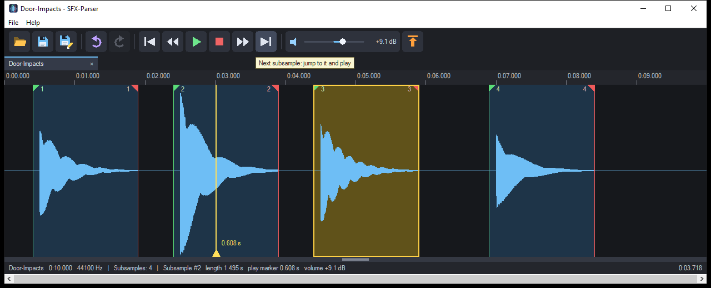

# SFX-Parser

Windows tool for cutting sound effects out of long recordings. Open WAV / MP3 / FLAC files (each in its own tab),
mark start and end points on the waveform, and save every cut as a numbered 256 kbps MP3.

## Controls
- Left click: new start point. Right click: new end point. Drag a marker to move it (Ctrl picks the start when markers overlap).
- Delete while hovering a marker removes it.
- Mouse wheel zooms around the cursor; Shift+wheel or middle drag scrolls; Ctrl+wheel or the bar under the waveform scales vertically.
- Toolbar: open, save all subsamples, save as (new name, then folder), undo/redo of volume effects, previous/next subsample, 3x fast backward/forward, play/pause, stop, volume (saved with the subsample) and maximize volume. Hovering a button highlights the subsamples it will affect.
- Space or middle click plays the subsample under the mouse; Space while playing stops. The yellow play marker is draggable. Saving stops playback.
- Drop files on the window, or select several in File > Open.
- File > Save Cuts writes `OriginalName_01.mp3`, `OriginalName_02.mp3`, ...

## Build
Pure C++ / Win32, no dependencies (decoding and MP3 encoding use Windows Media Foundation). With w64devkit in `C:\workenv\`:

    build.bat

`tools/makeicon.cpp` regenerates `src/app.ico`.

## License
MIT, see [LICENSE](LICENSE).

## Keys
Space / W play or pause in place (over another subsample: switch to it) - S stop or start from the beginning - A / D previous / next subsample -
Q / E volume +2% / -2% - F save all - R save all as - Z / C fast backwards / forward - Esc stop - Delete removes the hovered marker.
